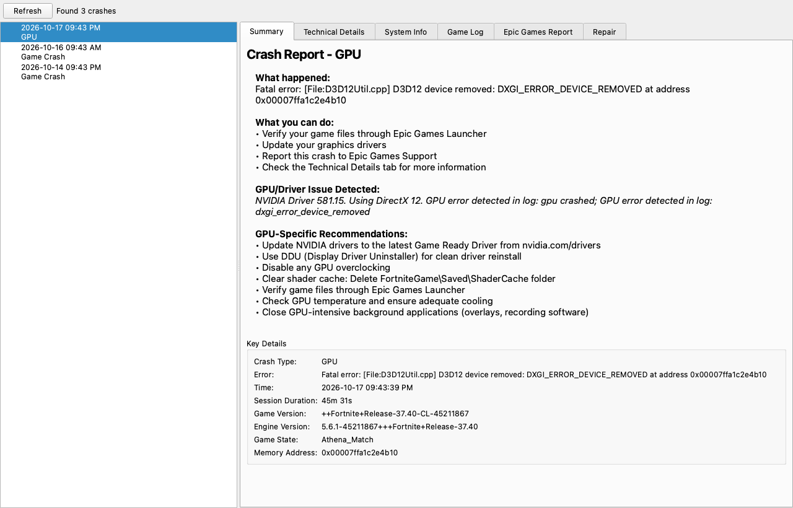

# Fortnite Crash Analyzer

A desktop application that helps inspect and understand Fortnite crash reports. It provides a simple UI to load CrashContext, minidump, and FortniteGame.log files, then summarizes technical details and offers actionable recommendations.



## Features
- Scan standard Fortnite crash folders and list available crash reports
- Parse CrashContext runtime XML, FortniteGame.log, and Windows minidump files
- Summarize likely crash causes in plain language
- Show technical details: call stacks, exception codes, registers, loaded modules
- Detect common GPU driver related issues and provide vendor-specific guidance
- Generate a formatted summary that you can paste into Epic Games crash reports

## Requirements
- Windows 10 or later
- Python 3.10+
- PyQt6

Install Python dependencies:

```bash
pip install -r requirements.txt
```

## Running the App
```bash
python main.py
```

The app will scan your default Fortnite crash directory and display available reports. Select a report to view summaries, logs, and technical details.

## Privacy and Safety
- Crash files are read from your local disk and never uploaded.
- For NVIDIA GPUs, the app looks up the latest driver on NVIDIA's public driver site, which sends NVIDIA your GPU model and nothing else.
- Verify paths before sharing logs or reports publicly.
- When reporting issues, remove any personal identifiers from logs.

## Development Notes
- Minidump parsing is optional. If the `minidump` library is not installed, advanced analysis is skipped.
- The UI is built with PyQt6 and uses standard widgets for readability.

## Contributing
Pull requests are welcome.

This project is not affiliated with or endorsed by Epic Games. Fortnite is a trademark of Epic Games, Inc.

## License
This project is licensed under the MIT License. See `LICENSE` for details.
